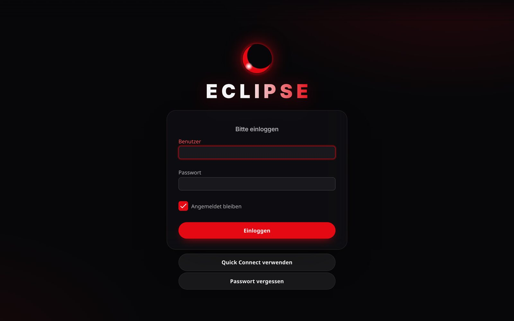
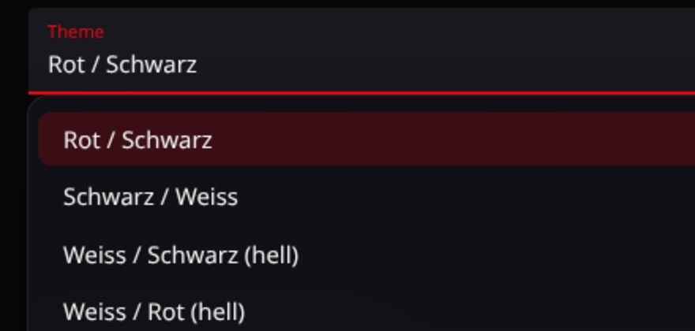

<div align="center">

# Jellywatch

**Better Designs for Jellyfin**

Ein dunkles, modernes Theme für **Jellyfin 12**. Es ist **nur CSS**: ohne JavaScript, ohne Plugins und ohne Internet-Zugriffe.

Logo „ECLIPSE“ · 6 Farbvarianten zum Auswählen · Slideshow mit den neuesten Filmen · „Anfragen“-Knopf für Seerr


</div>

---

## Inhalt

- [Was ist drin?](#was-ist-drin)
- [Installation (2 Minuten)](#installation-2-minuten)
- [Farbvariante wählen](#farbvariante-wählen)
- [Slideshow mit den neuesten Filmen](#slideshow-mit-den-neuesten-filmen)
- [Seerr: Filme anfragen, ohne die App zu wechseln](#seerr-filme-anfragen-ohne-die-app-zu-wechseln)
- [Anpassen (Name, Farben, Tempo)](#anpassen-name-farben-tempo)
- [Kompatibilität](#kompatibilität)
- [Häufige Fragen](#häufige-fragen)
- [Entfernen](#entfernen)
- [Sicherheit](#sicherheit)

---

## Was ist drin?

| | |
|---|---|
| 🎬 **Slideshow** | Die neuesten Filme laufen gross oben auf der Startseite durch, mit Poster, Titel und „Abspielen“-Knopf. |
| 🎨 **6 Farbvarianten** | Rot/Schwarz, Schwarz/Weiss, Weiss/Schwarz (hell), Weiss/Rot (hell), Blau/Schwarz, Violett/Schwarz. Jeder Benutzer wählt selbst. |
| 🌑 **Eigenes Logo** | Oben links steht **ECLIPSE** mit einer Sonnenfinsternis als Zeichen, statt „Jellyfin“. Name und Zeichen sind reines CSS. Den Namen änderst du mit einer Zeile. |
| ➕ **Seerr-Knopf** | Optional: ein „Anfragen“-Knopf direkt in der Kopfzeile, **ohne API-Key**. |
| 🪟 **Glas-Effekt** | Durchscheinende Kopfzeile, Menüs und Dialoge, runde Karten und Knöpfe. |
| 📱 **Handy** | Angepasst für schmale Bildschirme und die Jellyfin-App. |
| 🔒 **Sicher** | Lädt nichts nach, sendet nichts, enthält keine Geheimnisse. Wird bei jedem Push automatisch geprüft. |

<table>
<tr>
<td width="50%"><br><b>Detailseite:</b> grosser Titel, runde Knöpfe, Genres als Pillen.</td>
<td width="50%"><br><b>Bibliothek:</b> runde Karten mit leuchtendem Rand beim Drüberfahren.</td>
</tr>
<tr>
<td width="50%"><br><b>Anmeldung:</b> mit grossem Logo.</td>
<td width="50%" align="center"><br><b>Handy:</b> Slideshow und Detailseite.</td>
</tr>
</table>

---

## Installation (2 Minuten)

> Du brauchst ein **Administrator**-Konto in Jellyfin.

1. Öffne die Datei [`jellywatch.css`](jellywatch.css), klicke auf **„Raw“** und kopiere **den ganzen Text** (Strg+A, Strg+C).
2. In Jellyfin: oben rechts auf dein **Profilbild** → **Übersicht** (Dashboard).
3. Links im Menü auf **Branding**.
4. Den Text in das Feld **„Benutzerdefinierter CSS-Code“** einfügen.
5. Unten auf **Speichern** klicken.
6. Seite neu laden mit **Strg + F5** (Mac: **Cmd + Shift + R**). In der Handy-App die App einmal ganz schliessen und neu öffnen.

Fertig! 🎉 Das Theme gilt jetzt für alle Benutzer.

> 💡 **Warum kopieren und nicht einfach eine `@import`-Zeile?**
> So läuft genau der Code, den du gesehen hast, und niemand kann ihn später heimlich ändern.
> Mehr dazu in [SECURITY.md](SECURITY.md).

---

## Farbvariante wählen

Jeder Benutzer kann seine Farbe selbst wählen:
**Profilbild → Einstellungen → Anzeige → Theme**

| Theme in Jellyfin | Jellywatch-Farbe |
|---|---|
| Dark (Standard) | **Rot / Schwarz** |
| WMC | **Schwarz / Weiss** |
| Light | **Weiss / Schwarz** (hell) |
| Apple TV | **Weiss / Rot** (hell) |
| Blue Radiance | **Blau / Schwarz** |
| Purple Haze | **Violett / Schwarz** |


> 💡 Mit der optionalen [`extras/config.json`](extras/config.json) stehen im Menü direkt die richtigen Namen
> („Rot / Schwarz“, „Schwarz / Weiss“ …) statt „Dark“, „WMC“ usw. Siehe [nächster Abschnitt](#seerr-filme-anfragen-ohne-die-app-zu-wechseln).
>
> 

Die Anmeldeseite ist immer Rot/Schwarz, weil Jellyfin dort noch nicht weiss, welcher Benutzer kommt.

---

## Slideshow mit den neuesten Filmen

Oben auf der Startseite laufen die **8 neuesten Filme** als grosse Slideshow:

- wechselt alle **7 Sekunden** mit Überblendung, unten rechts zeigt ein Balken den Fortschritt
- **hält an**, solange die Maus darauf ist (oder ein Knopf darin ausgewählt ist)
- **Klick** auf Bild oder Titel öffnet den Film, **„Abspielen“** startet ihn sofort
- daneben die Knöpfe **Gesehen**, **Favorit** und **Mehr**
- oben links führt „Kürzlich hinzugefügt in Filme ›“ zur ganzen Liste

**Voraussetzung:** Unter **Einstellungen → Startseite** muss ein Bereich auf **„Kürzlich hinzugefügte Medien“** stehen.
Das ist in Jellyfin standardmässig so. Die Slideshow nimmt die erste Bibliothek vom Typ *Filme*. Wie die Bibliothek heisst, spielt keine Rolle.

> Ist auf dem Gerät „Bewegung reduzieren“ eingeschaltet, zeigt die Slideshow nur den neuesten Film ohne Animation.
> Im TV-Layout ist sie aus, damit schwache TV-Geräte flüssig bleiben.

---

## Seerr: Filme anfragen, ohne die App zu wechseln

Mit **[Seerr](https://github.com/seerr-team/seerr)** (früher Jellyseerr/Overseerr) können Benutzer neue Filme und Serien anfragen.
Jellywatch kann dafür einen **„Anfragen“-Knopf** direkt in die Jellyfin-Kopfzeile und ins Handy-Menü setzen:


Ein Klick öffnet Seerr in einem neuen Tab. Dort meldet man sich mit dem **Jellyfin-Konto** an.

> 🔒 **Warum kein API-Key?** Ein Theme kann aus reinem CSS keine Daten von Seerr laden. Dazu wäre JavaScript nötig.
> Ausserdem liefert Jellyfin den CSS-Code und die `config.json` an **jeden ohne Login** aus.
> Ein Seerr-API-Key darin wäre öffentlich und gäbe jedem Admin-Rechte in Seerr.
> Der Link-Knopf ist die sichere Lösung: Es gibt keinen Schlüssel, der gestohlen werden könnte.

### Einrichten

1. Lade [`extras/config.json`](extras/config.json) herunter.
2. Ersetze darin `https://seerr.example.com` durch die Adresse deines Seerr-Servers.
   Den Text „Anfragen“ und das Symbol (`add_circle`, ein [Material-Icon](https://fonts.google.com/icons)) kannst du anpassen.
3. Lege die Datei als `config.json` in den Web-Ordner von Jellyfin:

   | Installation | Pfad der `config.json` |
   |---|---|
   | **Docker** (offizielles Image `jellyfin/jellyfin`) | `/jellyfin/jellyfin-web/config.json`. Am besten als Volume einbinden, siehe unten. |
   | **Docker** (linuxserver.io) | `/usr/share/jellyfin/web/config.json` |
   | **Debian / Ubuntu** | `/usr/share/jellyfin/web/config.json` |
   | **Windows** | `C:\Program Files\Jellyfin\Server\jellyfin-web\config.json` |

   Docker Compose (offizielles Image):

   ```yaml
   services:
     jellyfin:
       image: jellyfin/jellyfin:latest
       volumes:
         - ./jellywatch-config.json:/jellyfin/jellyfin-web/config.json:ro
   ```

4. Jellyfin-Seite neu laden (Strg + F5).

> ⚠️ Ohne Docker überschreibt ein Jellyfin-Update die `config.json`. Behalte deine Kopie und lege sie nach Updates wieder hin.
>
> ⚠️ Trage deine **echte** Seerr-Adresse nur auf deinem Server ein, **nicht** in dieses öffentliche Repository.

**In Seerr selbst:** Unter *Einstellungen → Benutzer* die Anmeldung mit Jellyfin erlauben, die Jellyfin-Benutzer
importieren und ihnen das Recht zum Anfragen geben. Dann braucht niemand ein zusätzliches Passwort.

---

## Anpassen (Name, Farben, Tempo)

Füge im Feld **„Benutzerdefinierter CSS-Code“** **unter** dem Theme eigene Zeilen ein:

```css
:root {
    --jw-brand: "MEINKINO";        /* Name oben links und auf der Anmeldeseite (mit Anführungszeichen!) */
    --jw-hero-interval: 9s;        /* Sekunden pro Film in der Slideshow */
    --jw-hero-height: 70vh;        /* Höhe der Slideshow am Computer */
    --jw-hero-label: "NEU";        /* Schild über dem Filmtitel */
}
```

Eigene Akzentfarbe für alle Varianten, zum Beispiel Orange. Die Farbe immer als `#hex` **und** als Zahlen `R G B` angeben:

```css
:root {
    --jw-accent: #ff7a00;       --jw-accent-ch: 255 122 0;
    --jw-accent-hi: #ff9633;    --jw-accent-text: #ff9633;
    --jw-hero-accent: #ff7a00;  --jw-hero-accent-ch: 255 122 0;
}
```

> 💡 Jeder Benutzer kann so etwas auch nur für sich eintragen:
> **Einstellungen → Anzeige → Benutzerdefinierter CSS-Code**.

Slideshow ganz ausschalten: in `jellywatch.css` den Abschnitt **„6. SLIDESHOW“** löschen
(bis zum Anfang von „7. DETAILSEITE“).

---

## Kompatibilität

| | |
|---|---|
| ✅ **Jellyfin 12.x** | getestet mit **12.4.0**, Layout „Auto“ / Desktop / Mobil |
| ✅ Browser | Chrome, Edge, Firefox, Safari (aktuelle Versionen) |
| ✅ Apps mit Web-Oberfläche | Jellyfin Media Player, offizielle Android- und iOS-App |
| ⚠️ Ältere Browser | ohne `:has()` (z.B. Firefox vor 121, Safari vor 15.4): Theme ja, Slideshow nein (dann normale Reihe) |
| ⚠️ TV-Layout / „Legacy“-Layouts | Theme ja, Slideshow im TV-Layout bewusst aus |
| ❌ Native Apps | Android TV, Swiftfin, Findroid usw. laden kein eigenes CSS |
| ℹ️ Admin-Dashboard | Jellyfin 12 wendet dort kein eigenes CSS an, es bleibt unverändert |

---

## Häufige Fragen

<details>
<summary><b>Ich habe das CSS eingefügt, aber nichts hat sich verändert</b></summary>

1. Wurde unten auf **Speichern** geklickt?
2. Seite mit **Strg + F5** neu laden (der Browser merkt sich die alte Version).
3. Unter **Einstellungen → Anzeige** darf „Vom Server bereitgestellten, benutzerdefinierten CSS-Code deaktivieren“ **nicht** angehakt sein.
</details>

<details>
<summary><b>Die Slideshow fehlt</b></summary>

- Gibt es eine Bibliothek vom Typ **Filme**, in der etwas ist?
- Steht unter **Einstellungen → Startseite** ein Bereich auf **„Kürzlich hinzugefügte Medien“**?
- Ist die Filme-Bibliothek dort bei „Kürzlich hinzugefügt“ nicht ausgeschlossen?
- Ist der Browser aktuell genug (siehe [Kompatibilität](#kompatibilität))?
</details>

<details>
<summary><b>Ich will Filme auf mein Gerät herunterladen</b></summary>

Das kann Jellyfin selbst: auf der Detailseite **⋮ → Download**. Der Admin muss es pro Benutzer erlauben:
**Übersicht → Benutzer → (Benutzer) → „Mediendownloads zulassen“**.
</details>

<details>
<summary><b>Kann ich Seerr nicht direkt in Jellyfin einbauen, mit Suche und allem?</b></summary>

Mit reinem CSS nicht. Dafür bräuchte es JavaScript bzw. ein Server-Plugin, das den API-Key auf dem Server behält.
Jellywatch verzichtet bewusst darauf, damit das Theme so sicher wie möglich bleibt.
</details>

---

## Entfernen

1. **Übersicht → Branding** → den Jellywatch-Text aus „Benutzerdefinierter CSS-Code“ löschen → **Speichern**.
2. Falls benutzt: die eigene `config.json` wieder durch das Original ersetzen bzw. das Volume entfernen.
3. Seite mit **Strg + F5** neu laden. Jellyfin sieht wieder aus wie vorher.

---

## Sicherheit

- Reines CSS: kein JavaScript, kein `@import`, kein `url()`, keine externen Schriften oder Bilder.
- Keine API-Keys, keine Passwörter, keine echten Server-Adressen im Repository.
- Bei jedem Push prüft ein GitHub-Workflow automatisch, dass das so bleibt (`tools/check.py`).

Details und Tipps für das GitHub-Konto stehen in **[SECURITY.md](SECURITY.md)**.

---

<div align="center">

Gemacht für Jellyfin · [MIT-Lizenz](LICENSE)

Die Screenshots zeigen eine Test-Bibliothek mit erfundenen Filmen.

</div>
