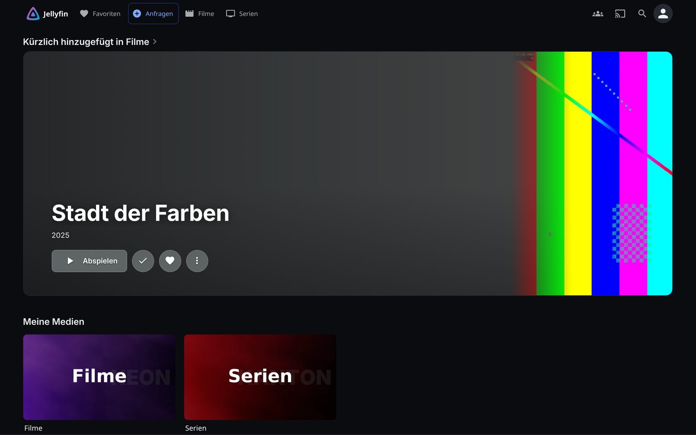
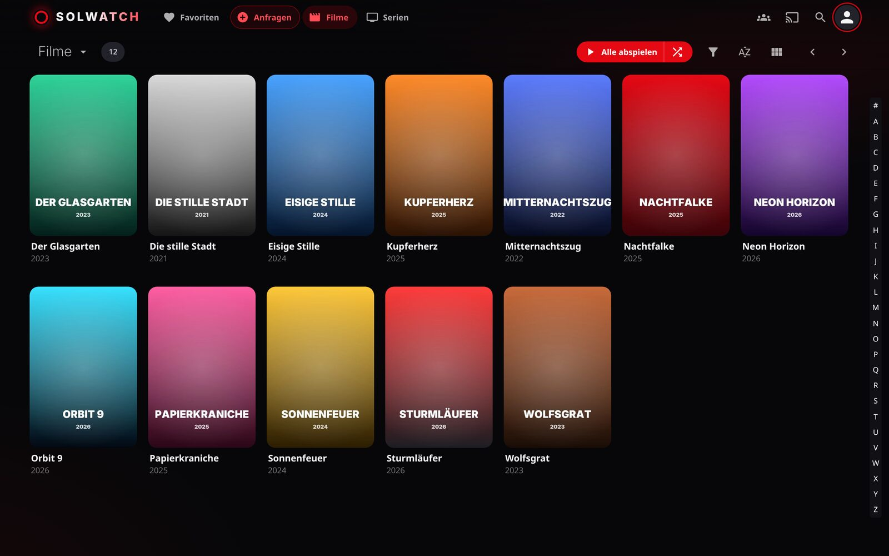
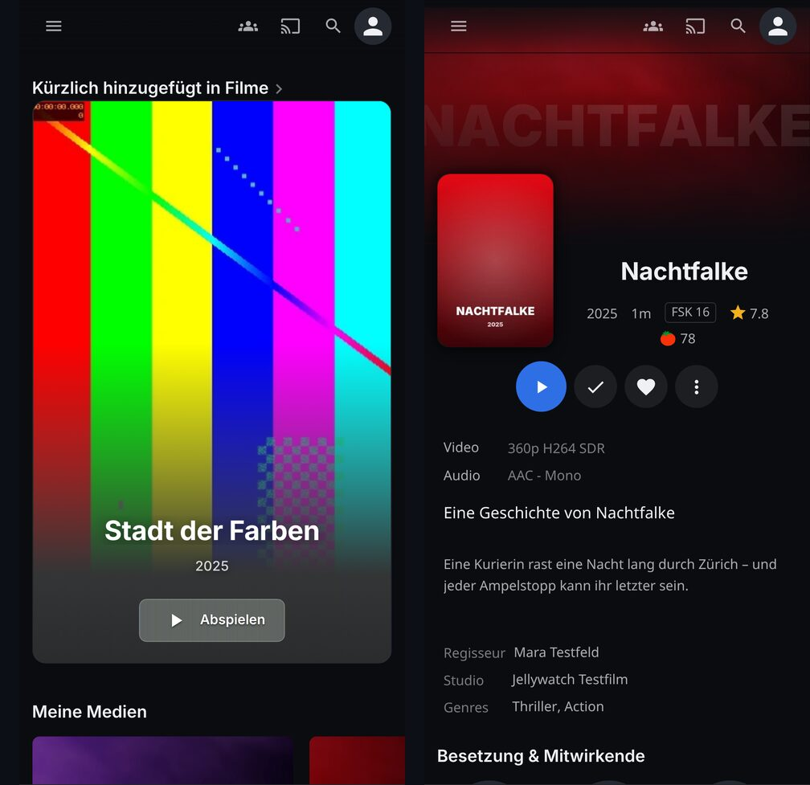
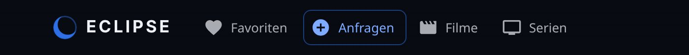

# Jellywatch

Better Designs for Jellyfin

Ein dunkles Theme für Jellyfin 12. Es besteht nur aus CSS: kein JavaScript, keine Plugins und keine Verbindungen ins Internet.



## Funktionen

- **Slideshow** oben auf der Startseite: 6 Filme aus den zuletzt hinzugefügten, mit grossem Poster und einem Hintergrund in der Farbe des Films. In Chrome, Edge und Safari wird bei jedem Laden zufällig ausgewählt.
- Die Knöpfe in der Slideshow übernehmen die **Farben des jeweiligen Films**.
- **Sechs Farbvarianten**, passend zu den Theme-Namen von Jellyfin. Jeder Benutzer wählt selbst.
- Optional ein Knopf **„Anfragen“** für Seerr, ohne API-Key.
- Angepasst für Computer, Handy und TV.

| Detailseite | Bibliothek |
|---|---|
|  |  |

| Anmeldung | Handy |
|---|---|
|  |  |

## Installation

Du brauchst ein Administrator-Konto in Jellyfin.

1. Öffne [`jellywatch.css`](jellywatch.css), klicke auf „Raw“ und kopiere den ganzen Text.
2. In Jellyfin: Profilbild oben rechts → **Übersicht** → links **Branding**.
3. Den Text in das Feld **„Benutzerdefinierter CSS-Code“** einfügen. Alter Inhalt kann ersetzt werden.
4. **Speichern** und die Seite mit **Strg+F5** neu laden (Mac: Cmd+Shift+R). In der Handy-App die App einmal ganz schliessen.

Das Theme gilt danach für alle Benutzer. Es wird bewusst kopiert und nicht per `@import` geladen. So läuft immer genau der Code, den du eingefügt hast (siehe [SECURITY.md](SECURITY.md)).

## Farbe wählen

Jeder Benutzer: **Einstellungen → Anzeige → Theme**.

| Theme in Jellyfin | Aussehen |
|---|---|
| Dark (Standard) | dunkel, blauer Akzent |
| Light | hell, blauer Akzent |
| Apple TV | hell, silbergrau |
| Blue Radiance | dunkelblau |
| Purple Haze | violett |
| WMC | blau mit grünem Akzent, wie Windows Media Center |


Die Anmeldeseite verwendet immer die Standardfarbe (Dark), weil Jellyfin dort den Benutzer noch nicht kennt.

## Slideshow

Die Reihe „Kürzlich hinzugefügt in Filme“ wird oben auf der Startseite zu einem grossen Banner mit 6 Filmen:

- Jellyfin liefert der Startseite die bis zu 16 neuesten Filme. Daraus wählt die Slideshow 6 aus.
- Das Poster steht gross und scharf am rechten Rand (am Handy oben) und läuft in eine Fläche in der Farbe des Films aus. Die Farbe berechnet der Browser aus dem Poster, ohne Zoom und ohne Weichzeichner.
- Der „Abspielen“-Knopf und die runden Knöpfe haben dieselbe Filmfarbe, so sieht jeder Film anders aus.
- Das breite Hintergrundbild, das auf der Detailseite eines Films zu sehen ist, kann die Slideshow nicht zeigen: Jellyfin setzt auf der Startseite nur das Poster in die Seite. Dafür bräuchte es JavaScript.
- In Browsern mit der CSS-Funktion `random()` (aktuelles Chrome, Edge und Safari) ist die Auswahl und Reihenfolge bei jedem Laden zufällig. Andere Browser zeigen die 6 neuesten.
- Wechsel alle 7 Sekunden. Solange die Maus darauf ist, bleibt sie stehen.
- Klick auf Poster oder Titel öffnet den Film, „Abspielen“ startet ihn.
- Ist „Bewegung reduzieren“ im System eingeschaltet, wird nur der neueste Film gezeigt. Im TV-Layout ist die Slideshow aus.

Voraussetzung: Unter **Einstellungen → Startseite** steht ein Bereich auf **„Kürzlich hinzugefügte Medien“** (Standard), und es gibt eine Bibliothek vom Typ Filme.

Zufällige Filme aus der ganzen Bibliothek (nicht nur aus den neuesten) sind mit reinem CSS nicht möglich, weil Jellyfin der Startseite keine anderen Filme mitgibt.

## Seerr-Knopf (optional)

[Seerr](https://github.com/seerr-team/seerr) ist für Anfragen nach neuen Filmen und Serien. Über die offizielle Web-Konfiguration von Jellyfin bekommt die Kopfzeile einen Knopf „Anfragen“, der Seerr in einem neuen Tab öffnet. Dort meldet man sich mit dem Jellyfin-Konto an.



Es gibt dafür keinen API-Key. Jellyfin liefert den CSS-Code und die `config.json` ohne Anmeldung aus, ein Schlüssel darin wäre also öffentlich.

Einrichten:

1. [`extras/config.json`](extras/config.json) herunterladen und `https://seerr.example.com` durch die Adresse deines Seerr-Servers ersetzen.
2. Die Datei als `config.json` in den Web-Ordner von Jellyfin legen:

   | Installation | Pfad |
   |---|---|
   | Docker (offizielles Image `jellyfin/jellyfin`) | `/jellyfin/jellyfin-web/config.json` |
   | Docker (linuxserver.io) | `/usr/share/jellyfin/web/config.json` |
   | Debian / Ubuntu | `/usr/share/jellyfin/web/config.json` |
   | Windows | `C:\Program Files\Jellyfin\Server\jellyfin-web\config.json` |

   Bei Docker Compose am besten als Volume:

   ```yaml
   services:
     jellyfin:
       image: jellyfin/jellyfin:latest
       volumes:
         - ./jellywatch-config.json:/jellyfin/jellyfin-web/config.json:ro
   ```

3. Seite mit Strg+F5 neu laden.

Ohne Docker überschreibt ein Jellyfin-Update die Datei. Dann die eigene Kopie wieder hineinlegen. Die echte Seerr-Adresse gehört nur auf den eigenen Server, nicht in dieses öffentliche Repository.

In Seerr unter *Einstellungen → Benutzer* die Anmeldung mit Jellyfin erlauben, die Benutzer importieren und ihnen das Recht zum Anfragen geben.

## Anpassen

Eigene Werte im Feld „Benutzerdefinierter CSS-Code“ **unter** dem Theme einfügen:

```css
:root {
    --jw-hero-interval: 9s;     /* Sekunden pro Film in der Slideshow */
    --jw-hero-height: 60vh;     /* Höhe der Slideshow am Computer */
}
```

Eigene Akzentfarbe, als `#hex` und als `R G B`:

```css
:root {
    --jw-accent: #2f6fe6;       --jw-accent-ch: 47 111 230;
    --jw-accent-hi: #4a86f0;    --jw-accent-text: #7eaaff;
}
```

Jeder Benutzer kann so etwas auch nur für sich eintragen: **Einstellungen → Anzeige → Benutzerdefinierter CSS-Code**.

Die Slideshow ganz ausschalten: in `jellywatch.css` den Abschnitt „6. SLIDESHOW“ bis zum Beginn von „7. DETAILSEITE“ löschen.

## Kompatibilität

- Jellyfin 12.x, getestet mit 12.4.0.
- Browser (Chrome, Edge, Firefox, Safari), Jellyfin Media Player und die offiziellen Android- und iOS-Apps, weil diese die Web-Oberfläche nutzen.
- Ältere Browser ohne `:has()` (z.B. Firefox vor 121, Safari vor 15.4): Theme ja, Slideshow nein.
- Native Apps (Android TV, Swiftfin, Findroid usw.) laden kein eigenes CSS.
- Das Admin-Dashboard bleibt unverändert, weil Jellyfin 12 dort kein eigenes CSS anwendet.

## Häufige Fragen

**Es hat sich nichts verändert.**
Wurde gespeichert? Seite mit Strg+F5 neu laden. Unter Einstellungen → Anzeige darf „Vom Server bereitgestellten, benutzerdefinierten CSS-Code deaktivieren“ nicht angehakt sein.

**Die Slideshow fehlt.**
Prüfe, ob es eine Filme-Bibliothek gibt, ob auf der Startseite „Kürzlich hinzugefügte Medien“ aktiv ist und ob die Filme-Bibliothek dort nicht ausgeschlossen ist.

**Filme auf das Gerät herunterladen?**
Das kann Jellyfin selbst über ⋮ → Download. Der Admin muss es pro Benutzer erlauben: Übersicht → Benutzer → „Mediendownloads zulassen“.

## Entfernen

Übersicht → Branding → den Text aus „Benutzerdefinierter CSS-Code“ löschen → Speichern → Strg+F5. Falls benutzt, die eigene `config.json` wieder durch das Original ersetzen.

## Sicherheit

Kein JavaScript, kein `@import`, kein `url()`, keine API-Keys und keine echten Adressen im Repository. Ein GitHub-Workflow prüft das bei jedem Push (`tools/check.py`). Details in [SECURITY.md](SECURITY.md).

Die Screenshots zeigen eine Test-Bibliothek mit erfundenen Filmen.

Lizenz: [MIT](LICENSE)
