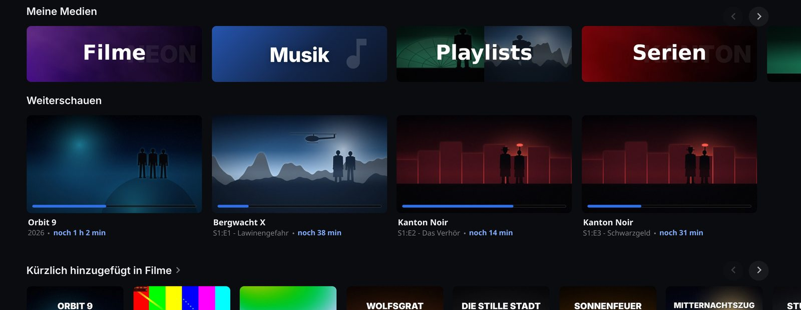
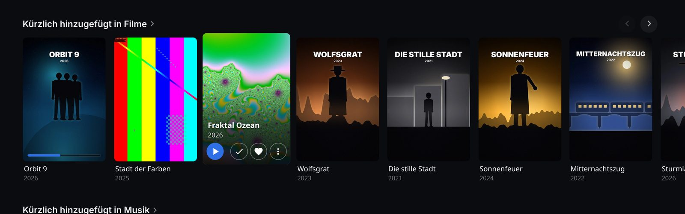
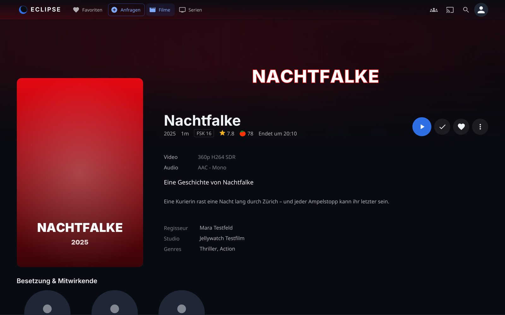
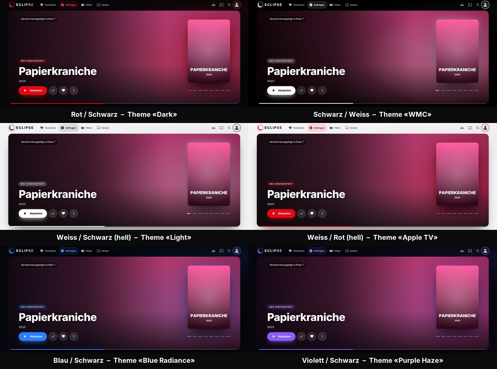
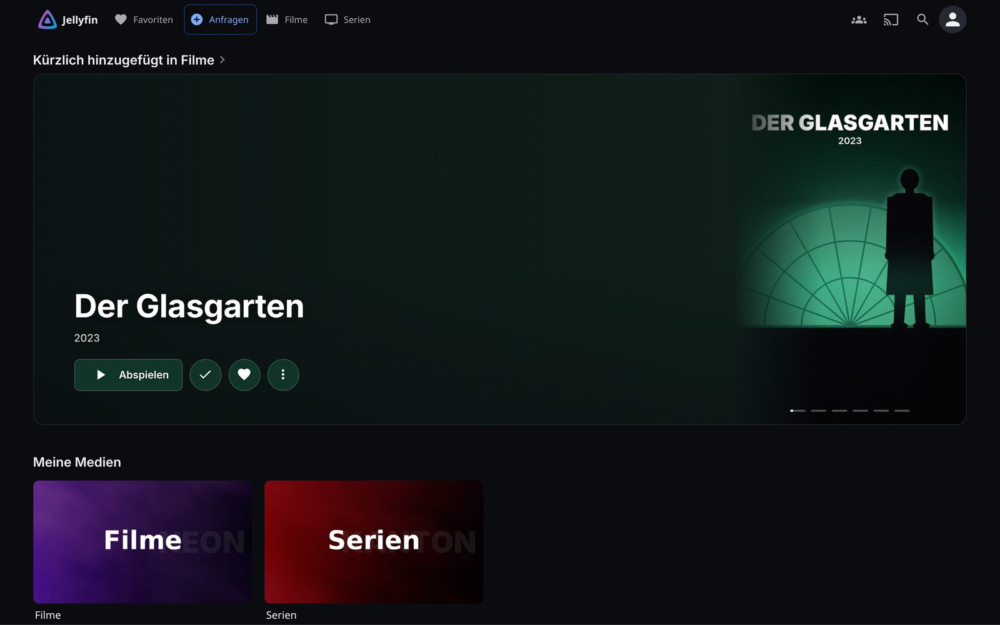

# Jellywatch

Better Designs for Jellyfin

Ein Theme für Jellyfin 12. Das Theme selbst ist reines CSS: keine Plugins und keine Verbindungen ins Internet. Dazu gibt es eine **optionale** Slideshow mit den grossen Hintergrundbildern der Filme (`jellywatch.js`).


## Funktionen

- **Slideshow** oben auf der Startseite mit 6 zufälligen Filmen: grosses Hintergrundbild, Logo, Beschreibung und Pfeile zum Vor- und Zurückblättern. Das braucht das optionale `jellywatch.js`. Ohne Skript zeigt eine reine CSS-Version die Poster der neuesten Filme.
- Die Knöpfe in der Slideshow haben die **Farbe des jeweiligen Films**.
- **Vorschau beim Drüberfahren:** Die Karte wird etwas grösser, die Knöpfe erscheinen auf dem Bild. Bei Postern rutschen auch Titel und Jahr aufs Bild, bei breiten Karten bleiben sie darunter.
- **„Meine Medien“ als flache Kacheln:** Der Name steht nur einmal da. Kacheln ohne Bild, z.B. Playlists, bekommen einen Farbverlauf mit dem Namen.
- **„Weiterschauen“** mit gut sichtbarem Fortschrittsbalken im Bild und der Restzeit, z.B. „noch 14 min“. Die Restzeit braucht `jellywatch.js`.
- **Sechs Farbvarianten**, passend zu den Theme-Namen von Jellyfin. Jeder Benutzer wählt selbst.
- Optional ein Knopf **„Anfragen“** für Seerr, ohne API-Key.
- Angepasst für Computer, Handy und TV.





| Detailseite | Bibliothek |
|---|---|
|  |  |

| Anmeldung | Handy |
|---|---|
|  |  |

## Installation

Du brauchst ein Administrator-Konto in Jellyfin.

### 1. Theme (CSS)

1. Öffne [`jellywatch.css`](jellywatch.css), klicke auf „Raw“ und kopiere den ganzen Text.
2. In Jellyfin: Profilbild oben rechts → **Übersicht** → links **Branding**.
3. Den Text in das Feld **„Benutzerdefinierter CSS-Code“** einfügen. Alter Inhalt kann ersetzt werden.
4. **Speichern** und die Seite mit **Strg+F5** neu laden (Mac: Cmd+Shift+R). In der Handy-App die App einmal ganz schliessen.

Das Theme gilt danach für alle Benutzer. Es wird bewusst kopiert und nicht per `@import` geladen. So läuft immer genau der Code, den du eingefügt hast (siehe [SECURITY.md](SECURITY.md)).

### 2. Slideshow mit Hintergrundbildern (optional)

Für die grossen Hintergrundbilder braucht es die kleine Datei [`jellywatch.js`](jellywatch.js). Sie wird einmal auf dem Server in die Weboberfläche von Jellyfin eingebunden und gilt dann für alle Benutzer, auch in den Apps für Android und iOS und im Jellyfin Media Player. Das Theme aus Schritt 1 muss installiert sein.

Was das Skript macht und was nicht, steht unter [Sicherheit](#sicherheit).

**Docker, offizielles Image `jellyfin/jellyfin`**

1. Neben der `docker-compose.yml` einen Ordner `jellywatch` anlegen und diese zwei Dateien hineinlegen: [`jellywatch.js`](jellywatch.js) und [`extras/jellywatch-inject.sh`](extras/jellywatch-inject.sh). Das zuerst machen, sonst legt Docker beim Start an ihrer Stelle leere Ordner an.
2. Die `docker-compose.yml` mit einem Editor öffnen (z.B. `nano docker-compose.yml`, das sind keine Befehle fürs Terminal) und beim Jellyfin-Dienst die `entrypoint`-Zeile und die zwei Volumes ergänzen. Die zwei Volume-Zeilen kommen unter dein bestehendes `volumes:`, kein zweites `volumes:` anlegen. Zum Einrücken nur Leerzeichen verwenden, keine Tabs:

   ```yaml
   services:
     jellyfin:
       image: jellyfin/jellyfin:latest
       # ... deine bisherigen Einstellungen bleiben ...
       entrypoint: ["/bin/sh", "-c", "sh /jellywatch/jellywatch-inject.sh /jellyfin/jellyfin-web; exec /jellyfin/jellyfin"]
       volumes:
         # ... deine bisherigen Volumes bleiben ...
         - ./jellywatch/jellywatch.js:/jellyfin/jellyfin-web/jellywatch.js:ro
         - ./jellywatch/jellywatch-inject.sh:/jellywatch/jellywatch-inject.sh:ro
   ```

3. Den Container neu erstellen und danach die Seite mit Strg+F5 neu laden:

   ```bash
   docker compose up -d
   ```

Bei jedem Start fügt das Skript eine Zeile in die `index.html` von Jellyfin ein, falls sie fehlt, und startet danach Jellyfin wie gewohnt. So funktioniert es auch nach einem Update des Images weiter. Fehlt eine der Dateien oder läuft der Container mit `user:` nicht als root, startet Jellyfin trotzdem normal, nur ohne Slideshow. Ob es geklappt hat, zeigt `docker logs jellyfin` mit einer Zeile, die mit `Jellywatch:` beginnt.

**Docker, Image von linuxserver.io**

1. Die zwei Dateien wie oben in einen Ordner `jellywatch` legen und das Skript ausführbar machen:

   ```bash
   chmod +x jellywatch/jellywatch-inject.sh
   ```

2. In der `docker-compose.yml` zwei Volumes ergänzen. linuxserver.io führt Skripte aus `/custom-cont-init.d` bei jedem Start aus:

   ```yaml
   services:
     jellyfin:
       image: lscr.io/linuxserver/jellyfin:latest
       volumes:
         # ... deine bisherigen Volumes bleiben ...
         - ./jellywatch/jellywatch.js:/usr/share/jellyfin/web/jellywatch.js:ro
         - ./jellywatch/jellywatch-inject.sh:/custom-cont-init.d/jellywatch.sh:ro
   ```

3. `docker compose up -d`, danach Strg+F5.

**Debian / Ubuntu ohne Docker**

Im Ordner dieses Repositories:

```bash
sudo cp jellywatch.js /usr/share/jellyfin/web/
```

```bash
sudo sh extras/jellywatch-inject.sh /usr/share/jellyfin/web
```

Ein Jellyfin-Update ersetzt die `index.html`. Danach beide Befehle wiederholen.

**Windows**

1. `jellywatch.js` nach `C:\Program Files\Jellyfin\Server\jellyfin-web\` kopieren.
2. Die Datei `index.html` im gleichen Ordner mit einem Texteditor als Administrator öffnen und direkt vor `</body>` diese Zeile einfügen:

   ```html
   <script defer src="jellywatch.js"></script>
   ```

3. Speichern und die Seite mit Strg+F5 neu laden. Nach jedem Jellyfin-Update wiederholen.

Wenn alles klappt, erscheint oben auf der Startseite die Slideshow mit Pfeilen. Sonst siehe [Häufige Fragen](#häufige-fragen).

## Farbe wählen

Jeder Benutzer: **Einstellungen → Anzeige → Theme**.

| Theme in Jellyfin | Aussehen |
|---|---|
| Dark (Standard) | dunkel, blauer Akzent |
| Light | hell, blauer Akzent |
| Apple TV | hell, silbergrau |
| Blue Radiance | dunkelblau |
| Purple Haze | violett |
| WMC | blau mit grünem Akzent, wie Windows Media Center |



Die Anmeldeseite verwendet immer die Standardfarbe (Dark), weil Jellyfin dort den Benutzer noch nicht kennt.

## Slideshow

**Mit `jellywatch.js`:**

- 6 zufällige Filme aus der ganzen Bibliothek, wenn möglich noch nicht gesehene. Beim Neuladen der Seite wird neu gemischt. Nach „Zurück“ bleiben dieselben Filme an derselben Stelle.
- Das grosse Hintergrundbild des Films wie auf der Detailseite, dazu Logo oder Titel, Jahr, Länge, Altersfreigabe, Bewertung, Genres und Beschreibung.
- Knöpfe „Abspielen“ (bei angefangenen Filmen „Fortsetzen“), „Mehr Infos“ und Favorit. Ein Rechtsklick öffnet das normale Jellyfin-Menü.
- Beim Drüberfahren erscheinen Pfeile links und rechts. Dazu Punkte unten rechts, die Pfeiltasten und Wischen auf dem Handy.
- Wechsel alle 7 Sekunden. Pause, solange die Maus darauf ist, ein Menü offen ist oder die Seite nicht sichtbar ist.
- Die Farbe der Knöpfe wird aus dem Hintergrundbild berechnet, so hat jeder Film seine eigene.
- Bilder werden erst geladen, wenn sie gebraucht werden.

**Nur CSS (ohne Skript):**



- Die Reihe „Kürzlich hinzugefügt in Filme“ wird oben zu einem grossen Banner mit 6 Filmen. Jellyfin liefert der Startseite die bis zu 16 neuesten Filme, daraus wählt die Slideshow 6 aus.
- Das Poster steht gross und scharf am rechten Rand (am Handy oben) und läuft in eine Fläche in der Farbe des Films aus. Die Knöpfe haben dieselbe Filmfarbe.
- In Browsern mit der CSS-Funktion `random()` (aktuelles Chrome, Edge und Safari) ist die Auswahl bei jedem Laden zufällig. Andere Browser zeigen die 6 neuesten.
- Wechsel alle 7 Sekunden, Pause solange die Maus darauf ist.
- Voraussetzung: Unter **Einstellungen → Startseite** steht ein Bereich auf **„Kürzlich hinzugefügte Medien“** (Standard), und es gibt eine Bibliothek vom Typ Filme.
- Mit reinem CSS gehen weder Pfeile noch Hintergrundbilder noch Filme aus der ganzen Bibliothek, weil Jellyfin der Startseite nur die Poster der neuesten Filme mitgibt. Dafür gibt es `jellywatch.js`.

In beiden Versionen gilt: Ist „Bewegung reduzieren“ im System eingeschaltet, wechselt die Slideshow nicht von selbst. Im TV-Layout ist sie aus.

## Seerr-Knopf (optional)

[Seerr](https://github.com/seerr-team/seerr) ist für Anfragen nach neuen Filmen und Serien. Über die offizielle Web-Konfiguration von Jellyfin bekommt die Kopfzeile einen Knopf „Anfragen“, der Seerr in einem neuen Tab öffnet. Dort meldet man sich mit dem Jellyfin-Konto an.


Es gibt dafür keinen API-Key. Jellyfin liefert den CSS-Code und die `config.json` ohne Anmeldung aus, ein Schlüssel darin wäre also öffentlich.

Einrichten:

1. [`extras/config.json`](extras/config.json) herunterladen und `https://seerr.example.com` durch die Adresse deines Seerr-Servers ersetzen.
2. Die Datei als `config.json` in den Web-Ordner von Jellyfin legen:

   | Installation | Pfad |
   |---|---|
   | Docker (offizielles Image `jellyfin/jellyfin`) | `/jellyfin/jellyfin-web/config.json` |
   | Docker (linuxserver.io) | `/usr/share/jellyfin/web/config.json` |
   | Debian / Ubuntu | `/usr/share/jellyfin/web/config.json` |
   | Windows | `C:\Program Files\Jellyfin\Server\jellyfin-web\config.json` |

   Bei Docker Compose am besten als Volume:

   ```yaml
   services:
     jellyfin:
       image: jellyfin/jellyfin:latest
       volumes:
         - ./jellywatch-config.json:/jellyfin/jellyfin-web/config.json:ro
   ```

3. Seite mit Strg+F5 neu laden.

Ohne Docker überschreibt ein Jellyfin-Update die Datei. Dann die eigene Kopie wieder hineinlegen. Die echte Seerr-Adresse gehört nur auf den eigenen Server, nicht in dieses öffentliche Repository.

In Seerr unter *Einstellungen → Benutzer* die Anmeldung mit Jellyfin erlauben, die Benutzer importieren und ihnen das Recht zum Anfragen geben.

## Anpassen

Eigene Werte im Feld „Benutzerdefinierter CSS-Code“ **unter** dem Theme einfügen:

```css
:root {
    --jw-hero-interval: 9s;     /* Sekunden pro Film in der Slideshow */
    --jw-hero-height: 60vh;     /* Höhe der Slideshow am Computer */
}
```

Eigene Akzentfarbe, als `#hex` und als `R G B`:

```css
:root {
    --jw-accent: #2f6fe6;       --jw-accent-ch: 47 111 230;
    --jw-accent-hi: #4a86f0;    --jw-accent-text: #7eaaff;
}
```

Die kleinen Namen unter den Kacheln von „Meine Medien“ wieder anzeigen. Das ist nötig, falls deine Bibliotheks-Bilder keinen Namen enthalten:

```css
.homeSectionsContainer .card[data-type="CollectionFolder"]:not(:has(.defaultCardBackground)) .cardText {
    display: block !important;
}
```

Das Skript `jellywatch.js` ausschalten, ohne etwas am Server zu ändern. Dann gilt wieder die CSS-Slideshow, und die Restzeit fällt weg:

```css
:root {
    --jw-js: 0;
}
```

Jeder Benutzer kann so etwas auch nur für sich eintragen: **Einstellungen → Anzeige → Benutzerdefinierter CSS-Code**.

Die CSS-Slideshow ganz ausschalten: in `jellywatch.css` den Abschnitt „6. SLIDESHOW“ bis zum Beginn von „6b.“ löschen.

## Kompatibilität

- Jellyfin 12.x, getestet mit 12.4.0 (offizielles Docker-Image und linuxserver.io).
- Browser (Chrome, Edge, Firefox, Safari), Jellyfin Media Player und die offiziellen Android- und iOS-Apps, weil diese die Web-Oberfläche vom Server laden. Das gilt für das Theme und für `jellywatch.js`.
- Ältere Browser ohne `:has()` (z.B. Firefox vor 121, Safari vor 15.4): Theme ja, CSS-Slideshow nein.
- Native Apps (Android TV, Swiftfin, Findroid usw.) laden weder eigenes CSS noch das Skript.
- Das Admin-Dashboard bleibt unverändert, weil Jellyfin 12 dort kein eigenes CSS anwendet.

## Häufige Fragen

**Es hat sich nichts verändert.**
Wurde gespeichert? Seite mit Strg+F5 neu laden. Unter Einstellungen → Anzeige darf „Vom Server bereitgestellten, benutzerdefinierten CSS-Code deaktivieren“ nicht angehakt sein.

**Die Slideshow mit Hintergrundbildern erscheint nicht.**
- Das Skript läuft nur zusammen mit dem Theme. Ist das CSS aus Schritt 1 installiert?
- Ist die Zeile eingebunden? Im Browser die Adresse deines Servers mit `/web/index.html` am Ende öffnen, mit Strg+U den Quelltext anzeigen und nach `jellywatch.js` suchen.
- Mit Strg+F5 neu laden. Falls etwas nicht klappt, steht in der Browser-Konsole (F12) eine Meldung mit `[Jellywatch]`.
- Es werden nur Filme mit Hintergrundbild gezeigt. Gibt es keine, bleibt die CSS-Version.

**Die CSS-Slideshow fehlt.**
Prüfe, ob es eine Filme-Bibliothek gibt, ob auf der Startseite „Kürzlich hinzugefügte Medien“ aktiv ist und ob die Filme-Bibliothek dort nicht ausgeschlossen ist.

**Filme auf das Gerät herunterladen?**
Das kann Jellyfin selbst über ⋮ → Download. Der Admin muss es pro Benutzer erlauben: Übersicht → Benutzer → „Mediendownloads zulassen“.

## Entfernen

- **Theme:** Übersicht → Branding → den Text aus „Benutzerdefinierter CSS-Code“ löschen → Speichern → Strg+F5.
- **Skript mit Docker:** die `entrypoint`-Zeile (nur beim offiziellen Image) und die zwei Jellywatch-Volumes aus der `docker-compose.yml` löschen und `docker compose up -d` ausführen. Der neue Container hat wieder die originale `index.html`.
- **Skript ohne Docker:** die Zeile `<script defer src="jellywatch.js"></script>` aus der `index.html` löschen und `jellywatch.js` löschen. Ein Jellyfin-Update stellt die originale `index.html` ebenfalls wieder her.
- **Seerr-Knopf:** die eigene `config.json` wieder durch das Original ersetzen.

## Sicherheit

**Theme:** reines CSS. Kein `@import`, kein `url()`, keine API-Keys und keine echten Adressen im Repository.

**`jellywatch.js`:**

- spricht nur mit deinem eigenen Jellyfin-Server und nutzt die Anmeldung, die im Browser schon besteht. Es enthält keine Adressen zu anderen Servern.
- stellt nur lesende Anfragen: 6 zufällige Filme für die Slideshow, dazu Laufzeit und Fortschritt der Karten bei „Weiterschauen“ für die Restzeit. Jeder Benutzer sieht nur, was er sehen darf. Abspielen, Favorit und das Menü erledigt Jellyfins eigener Code.
- fügt Titel und Beschreibungen nur als Text ein, nie als HTML.
- speichert nichts und liest keine Passwörter oder Tokens.
- Wenn etwas schiefgeht, verschwindet die Slideshow und die CSS-Version bleibt.

Ein GitHub-Workflow prüft CSS und Skript bei jedem Push (`tools/check.py`). Details in [SECURITY.md](SECURITY.md).

Die Screenshots zeigen eine Test-Bibliothek mit erfundenen Filmen und selbst gezeichneten Bildern.

Lizenz: [MIT](LICENSE)
